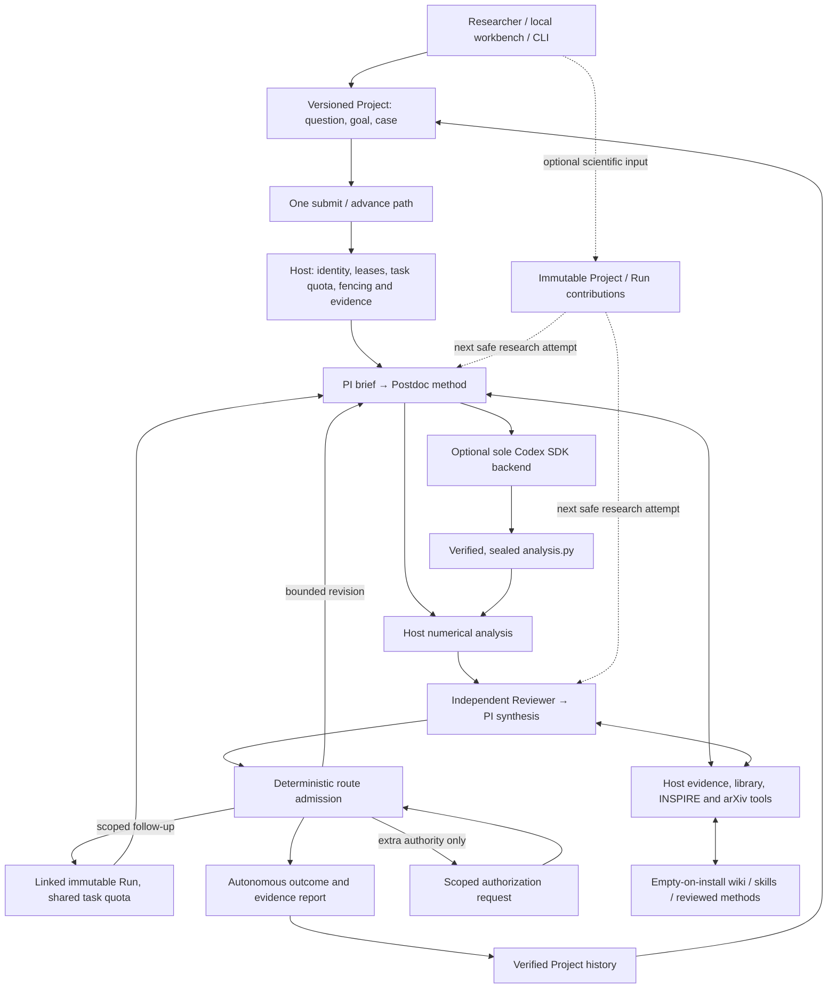

# Architecture

The product is a project-based LQCD research collaboration. PI/Postdoc planning, one Codex coding backend, actual numerical execution and independent Reviewer/PI synthesis run over the existing trusted control plane. Research can conclude without human participation. Operator scientific input is optional; extra execution authorization remains explicit.

## One execution authority

`runtime.py` accepts `ApplicationRequest` from CLI, Python and the loopback workbench. `submit` commits the business action; `advance` drives eligible admitted work. LangGraph routes over committed transitions. The shared native Host driver owns one file lock and uses the existing durable records as its queue. The browser has no second execution cursor or task database. Live scientific CLI work launches this same driver when work remains; the standalone Code demonstration retains its explicit delivery interface.

The control plane owns Run identities, authorization, leases, idempotency, cancellation and publication. WAL/FULL storage, boot/PID checks, source fencing and immutable accepted results remain. Coordinator schema 3 includes the shared research-task quota and rejects old Hosts. There is no in-place migration or rewriting of old accepted results; an original Host needs its original supported runtime. Scientific artifact and execution schemas retain their separately declared versions.

A Project is scientific context. Each Run binds its Project revision, goal, dataset identity, case configuration and exact selected method sources. Project edits affect later admissions. The Project store cannot resume execution or grant authority. Exact committed request-key replay returns the original business result; a conflicting intent is rejected.

## Research roles and SDK boundaries

`research/collaboration.py` reuses `ScientificAgent` and the strict proposal contracts. A planning attempt contains PI → Postdoc; a review attempt contains independent Reviewer → PI synthesis. These are separate model contexts inside the canonical work kinds. They share the configured research model; context separation alone does not establish independent model-family agreement or physical correctness. Analysis is Host execution, and coding uses the sole `code_agent/backend.py` interface.

The Python OpenAI Agents SDK supplies bounded tools and structured output. Research transport retries, SDK sessions, handoffs, nested agents and SDK-owned approvals are disabled. The balanced policy permits eight model calls per research attempt, including compaction; the first role uses at most half the remaining turns, leaving a conclusion allowance for the second. The final allowance uses `tool_choice=none`, and Host hooks refuse a contrary tool effect. Incomplete responses remain failures. Tools execute serially with separate admission and settlement.

`ResearchMeter` admits each model/tool effect through its original scope. The original invocation lease, policy and per-request deadlines still apply. Cancellation drains owned effects; uncertain settlement cannot authorize redispatch. The request timeout is distinct from the original attempt window and the shared task dispatch deadline.

All deployment token limits are defined in [`settings.py`](../src/lqcd_agent/settings.py). Complete explicit inputs are counted before dispatch, including instructions, messages, tools and output schema. The hard input ceiling is 256,000; both research and Code use the same 194,560-token compaction setting. Research generation permits 32,768 output tokens including reasoning. Native Code has an explicit 128,000-token output cap, a 243,200-token effective window and native compaction. The Code loopback gateway independently recounts every actual request after tool output, retry or compaction.

Research compaction retains initial scientific state verbatim, including the task, supplied constraints, diagnostics, unresolved issues and source identities. Full original evidence remains available. Protected state alone can exceed the soft threshold up to the hard ceiling. Counting failure, an oversized input or insufficient post-compaction headroom stops dispatch; no silent truncation occurs. Native compaction is observed from SDK events and provides working context, not new scientific evidence.

Command tools use the pinned native managed proxy with public-domain access, the default local/private-target guard, no Unix-socket allowlist, an ephemeral HTTP listener and SOCKS disabled. The SDK uses `ApprovalMode.deny_all` (native `never`), so a model cannot approve an escalation to reopen those boundaries. Model transport to the private loopback gateway remains outside the command sandbox. Numeric analysis and method/case calibration have network disabled, with that policy bound in their execution preparation.

The gateway uses one HTTPX pool per worker, rejects implicit remote history, alternate models/routes, WebSockets and automatic truncation, and owns connections through shutdown. Only read-only counting retries broken connections, at most three times inside its original deadline. The gateway never redispatches generation itself; native Codex owns transient generation recovery, and each repeated request is freshly counted and admitted. Unknown usage retains conservative reservations. Private traces contain digests/counts and bounded diagnostics, not credentials or request/error bodies. The native SDK writes files and returns paths; the Host independently verifies and seals their actual bytes.

## Autonomous conclusions and scoped experiments

Normal scientific review no longer requires human approval. A terminal report records `scientific_outcome` (`supported`, `qualified`, `inconclusive`) and `decision_origin=system`, along with evidence and classification reasons. Ordinary caveats can yield a qualified system conclusion. Failed numerical contracts, blocked claims, incomplete evidence and exhausted budgets produce an inconclusive result. An accepted terminal classification is a scoped recorded conclusion, not proof that every physical assumption is correct.

PI/Reviewer questions and answers retain attributable evidence. Disagreement or warnings cannot be erased to permit closure. Concrete executable revisions use the original bounded routes. Missing information can end the investigation inconclusively without waiting for an operator. A target exception is still propagated after a verified finished/failed Attempt without a registered result completes the original control closure; the same Project capture path saves the actual failure. Started or uncertain effects are not redispatched or automatically declared closed. Actual permission responses are recorded as `authorization_decision`, separately from scientific adjudication and operator contributions. A permissions/budget authorization or refusal cannot be relabeled as scientific endorsement or rejection. The human gate remains for explicit additional authority; it does not grant permission to bypass data-integrity, security or policy failures.

PI can return a typed `next_experiment` in the sealed review collaboration. `research/experiments.py` admits supported parameter changes and reviewed local method selections through the original Host start path. New Runs retain the same dataset identity, interpreter, execution permissions and research-task account, and link back to the exact parent proposal/evidence. Source data cannot be replaced. Child slots are reserved before start for exact crash/idempotency reconciliation. Unsupported, repeated/no-progress or quota-exhausted proposals are recorded as unexecuted with a reason, rather than creating an endless driver loop.

The default shared task quota in `settings.py` permits four Runs, 128 actual model requests, 8,000,000 explicit input-plus-output reservation units and a 3,600-second dispatch deadline. Research and native Code generation/compact requests, including SDK repeats, consume the same coordinator account. Starting another Run or reconnecting cannot replenish it. Missing usage keeps the maximum reservation. These units do not include every provider-internal context or hosted-tool fee and are not a USD billing ceiling. Already admitted work and cleanup remain constrained by their original fences and deadlines.

## Empty local assets and reuse

Each installation initializes empty `library/wiki`, `library/skills` and `library/methods`; no personal wiki is imported. Assets have immutable versions, applicability, source references, dependencies and candidate/reviewed/contested/superseded states. Review records attribute the actual operator or agent rather than inventing human approval.

Research tools can save candidates and independently review prior-attempt candidates using supporting evidence actually read in that attempt. Wiki/skill review remains an attributable scoped judgment. Method promotion additionally requires Host-executed finite independent calibration for the current C2 or Normalization family and exact source binding. An uploaded `passed: true` receipt cannot register a method. Unsupported generic contracts remain candidates. Finite calibration does not establish universal physics validity.

A selected reviewed method version is atomically snapshotted with source, applicability and validation identity. Admission freezes it into read-only `reused/` inputs for the sole Code backend. Final generated analysis remains self-contained. Stale, contested or changed dependencies cannot enter under an old review. The operator CLI uses the same lifecycle; method registration takes `--family` and `--python`, and executes Host calibration.

## Evidence and numerical contracts

Run input bytes, code, interpreter/library identity, parameters and outputs are bound by the existing evidence path. Model proposals select domain choices; Host code constructs executable paths. C2, Normalization and `replica_observables` retain deterministic Host checks. The general replica interface checks explicit sample identities and declared estimators without inferring physical configuration independence, units or resampling provenance.

Reviewer initial views retain Host findings and reference the full method through a digest-bound named read. Complete context, registered artifacts and Project/library evidence remain available through paginated tools. INSPIRE metadata and arXiv HTML use fixed public hosts, retained source hashes and bounded text reads; unavailable papers and uninspected figures remain explicit.

Optional operator contributions have immutable versioned records, exact Project identity, optional Run/head scope and registered evidence references. They enter PI/Reviewer context at a later safe attempt, with full records available through named reads. Free text grants no authority and does not mutate sealed results or restart a closed Run.

`ProjectStore.capture_run` verifies registered producer scopes and copies bound evidence. Outcomes and actual decision provenance come from the terminal artifact and committed closure, rather than a required human approval. Project copies remain read-only history after Host loss, with no raw-data backup or recovery authority. Portable terminal archives retain their separate existing contract.

## Local deployment

The workbench uses loopback, exact origin, a session token, bounded JSON and registered evidence reads. Its navigation pointer contains only the managed Host locator. The shared CLI/workbench driver preserves the original workspace and private `.env`; keys are never sent to the browser or exported into child environments. Status does not launch a driver, renew authority or run a model. An actually absent old Host permits new work in a new Host; unsafe existing authority is not replaced.

Qualified execution remains native macOS with the canonical `/private/tmp` parent and owned local storage. Linux source/build checks do not qualify runtime execution. HPC, distributed workers, generic PI/Reviewer shell access and arbitrary-QCD physics certification remain outside the implementation.
