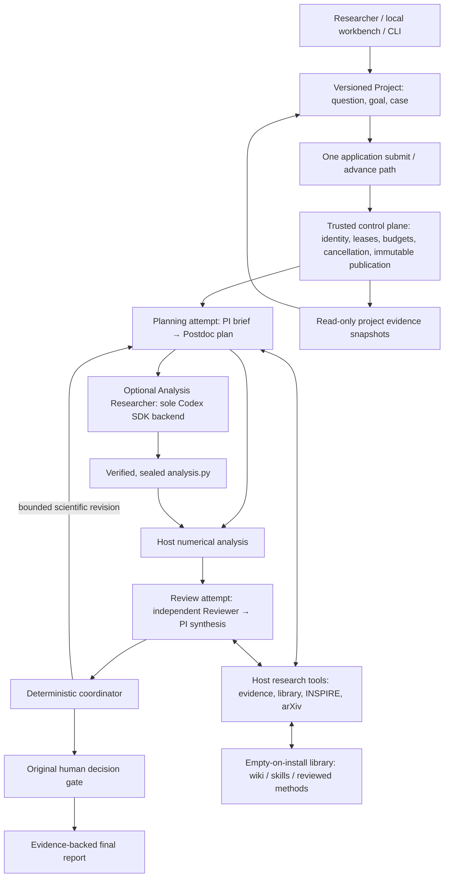

# Architecture

The product is a project-based LQCD research collaboration. A PI frames the question and challenges the interpretation; a Postdoc converts it into an executable method; an Analysis Researcher uses the one Codex backend when code is needed; an independent Reviewer examines evidence before the PI recommends the next action. Human scientific acceptance and execution authority remain outside these model roles.

## One execution authority

`runtime.py` accepts `ApplicationRequest` for CLI, Python and the loopback workbench. `submit` commits a business action; `advance` drives that admitted work. The worker uses the same `CanonicalProductRuntime` and durable intents. LangGraph routes over committed transitions; neither the browser nor the research SDK maintains a second execution cursor or task database.

The control plane owns Run identities, authorization, leases, idempotency, resource admission, cancellation and publication. Existing schema `0.4`, WAL/FULL storage, boot/PID checks, source fencing and immutable accepted results remain. A repeated committed start with the same Host/key and exact request intent returns its original Run without rereading changed project or method inputs. A conflicting intent is rejected. Only the current execution layout is supported. Retired Code fields and old-version dispatch paths are absent; original Hosts from earlier builds require their original supported runtime rather than an in-place migration.

Projects are versioned scientific context. A Run freezes project ID, revision, digest and snapshot in its root goal, together with case configuration, dataset identity and explicitly selected method sources. Editing a Project affects subsequent Runs. The Project store cannot resume a Run, manufacture approval or replace control records. No separate project scheduler is introduced.

## Research roles and SDK boundaries

`research/collaboration.py` reuses `ScientificAgent` and the existing strict method/review proposal schemas. The canonical planning attempt contains PI → Postdoc calls; the canonical review attempt contains independent Reviewer → PI calls. These are separate model contexts, not four new control-plane node types. They currently share the application-configured model; context separation does not establish independent model families or physics validation. The external Reviewer receives the evidence packet before the current PI synthesis. Analysis is performed by Host code; coding remains in `code_agent/backend.py`'s sole Code backend interface.

The Python OpenAI Agents SDK supplies bounded tool loops and structured output. The application constructs a model client with retries disabled. An attempt owns one event loop and client lifetime. There are no SDK handoffs, SDK sessions, hosted tools, model-as-tool calls or SDK-owned approvals. Roles share the invocation’s remaining model-call allowance. The first role reserves one call for the second, within the existing four-call attempt budget; research compaction also consumes this allowance. Each role is told its available turns, and research generation allows up to 4,096 output tokens. The model may request several tools in one response, while Host execution remains serial with separate admission and settlement for each effect. This bounded allocation permits dependent evidence reads without increasing Host limits.

`ResearchMeter` admits every model/tool effect through the existing resource scope before it occurs. Each completed effect records its evidence and measured tokens when raw provider usage exists; absent usage remains unknown. Errors and cancellation preserve conservative charges, never justify uncertain redispatch, and cannot renew expired authority. The first actual model call retains the canonical `domain-diagnosis` causal anchor. Deterministic analysis inspection is counted as a tool, while generated numerical execution retains its separate subprocess resource. Request and attempt time limits are separate: the configured request bound applies to each generation, count, compact and tool effect, while the attempt remains inside its original Host lease and remaining policy budget, reserving 30 seconds for cleanup and settlement. Generation uses the SDK timeout; direct API and tool calls use cooperative async cancellation, preserving any shorter tool deadline. Cleanup is awaited before failure settlement. The requested attempt window is the existing 900-second policy limit, not a renewal or additional budget.

For the current Terra configuration, every complete explicit research input is counted through the provider input-token endpoint before generation, including instructions, messages, tool definitions and output schema. The hard ceiling is 256,000 input tokens. Above 204,800 tokens, accumulated working history is compacted under Host admission, then counted again. Initial scientific state stays verbatim: the task, supplied constraints, Host diagnostics, unresolved issues and source identities are not replaced by the compacted history. If only this protected state exceeds the soft threshold, it remains intact up to the hard ceiling. Count failure, an oversized request or compaction that does not restore headroom stops execution; an over-limit request is not sent even for compaction. Original evidence and exchanges remain retained, and no silent truncation is permitted. These are deployment limits, not a guarantee for every model or a total Run token/cost budget.

The Code backend uses native Codex compaction with a 243,200-token effective window (95% of the configured 256,000) and a 194,560-token compaction threshold. Its loopback HTTP gateway independently counts every complete explicit model input before forwarding it, enforcing the 256,000-token hard ceiling even after tool output or native compaction. It rejects implicit server-side history, alternate models/routes, WebSocket transport and automatic truncation. Count, limit or upstream failure closes further upstream admission; cancellation closes active connections. The gateway retains request digests and counts, not request bodies or credentials. Native compaction is tracked from SDK events, not inferred from the HTTP route; it supplies working context, not new scientific evidence. The input ceiling covers explicit serialized requests, not provider-internal hosted-tool context or cumulative usage.

Discussion artifacts retain questions, responses, attributable references, independent review and PI recommendations. A named source must exist in supplied/registered/read evidence before it can support an addressed issue; existence does not prove the response is scientifically sound. The initial project view projects current unresolved issues, conflict summaries, counts and source-linked conditionally accepted conclusions, rather than all historical exchanges. Conflicting dispositions or answers remain unresolved, with all original responses and references retained in the full state. Accepted conclusions require captured evidence of actual human acceptance. Complete history, conflict variants and evidence indexes are available through named paginated reads, without a fixed history byte ceiling or silent truncation.

## Scientific revision and final judgment

A successful review can request a real `replan` cycle only when its Host-admitted diagnostic has a unique planner target, bounded retryability, no human need and low/medium risk. The collaboration adapter permits this only when the retained Host report has no warnings/errors and the PI requests concrete remaining checks. It never removes Host diagnostics to obtain that condition. Revision uses existing cycle and replan budgets, preserves prior artifacts and passes questions as remediation success criteria.

Scientific revision is not a numerical failure. It does not create a failure fingerprint, borrow a stale failure's repeat count or obtain a failure-specific budget grant. Unsafe, ambiguous or information-dependent proposals reach the original human gate; exhausted budgets produce their normal stop outcome. An unresolved scientific revision cannot be classified accepted. Final scientific review still requires the original recorded human decision.

PI checks constrain executable method steps and coding requirements. Agents cannot change the frozen raw input or widen a result contract mid-Run. A new dataset, physical definition or incompatible analysis contract requires an explicit new Project revision/Run. Additional agents and model consensus are not independent physics validation.

## Empty local assets and reuse

A fresh installation contains no user knowledge, tools or scientific methods in `library/`. Built-in numerical programs and synthetic fixtures are product capabilities, not a prepopulated user knowledge base. Nothing reads or imports an external private wiki.

- `library/wiki`: claims, source references and applicability.
- `library/skills`: procedural guidance with the same provenance and review lifecycle.
- `library/methods`: one descriptor and one current Python implementation per reusable method.
- `projects/<id>`: immutable metadata revisions and captured research evidence. Operator-authored code and validation evidence may also live here.
- `.runtime`: private workbench navigation metadata, not scientific knowledge or control authority.

Assets begin as candidates. Edits return reviewed content to candidate. Reviewed, contested and superseded dispositions retain exact operator receipts and evidence; dependencies identify versions and reveal changes. Models may save candidates but cannot review/promote them. Method registration requires source-bound validation records and explicit operator review; the registration command does not run those validations or certify their scientific sufficiency.

`Library.method_snapshot` reads metadata and verified source bytes under one lock. A Run's `method_dependencies` must match currently reviewed versions and unchanged dependencies. Frozen sources enter a content-addressed coding base as read-only `reused/<id>.py` files. Codex must deliver a self-contained `analysis.py`; registered methods do not receive an alternative direct execution path. Different method versions use distinct immutable bases under the same Code backend.

Search is local text plus metadata. There is no vector database, knowledge graph, automatic self-promotion or hidden imported corpus. See [library conventions](../library/README.md).

## Evidence and numerical contracts

Scientific starts freeze raw CSV/JSON content identity, including absence. Analysis hashes the exact stream it consumes. Replay/fork inherit the source; changed data require a new Run. Frozen parameters cannot replace source fields. Sealed code, input identity and interpreter/library identity are verified before isolated execution.

`analysis/generated_diagnostics.py` remains the canonical Host validator. C2 and Normalization retain their existing domain checks. `replica_observables` adds explicit physical definitions, units, kinematics, group identity, original sample IDs, failed samples and bootstrap/jackknife arithmetic. It does not claim independent verification of the fit, physical definition, pairing provenance or systematic errors. Those limitations are always Host warnings. See [research contracts](RESEARCH_CONTRACTS.md).

Initial views select relevant scientific state; complete content-addressed context bundles remain available. The Reviewer initially receives the method-step count and an explicit instruction to read the complete `method_plan`, rather than duplicating every step in the initial view. Host warnings, findings and evidence are retained. SDK tools can read named full sections, registered artifacts and local assets. Project evidence reads are bound to the current Run’s frozen Project identity; models do not supply a project ID, and unbound Runs do not expose that tool. INSPIRE metadata and arXiv HTML readers use fixed public hosts, bounded responses, retained source hashes and paginated text. Unavailable HTML is explicit; abstracts are not substituted for full-paper reading. Embedded figures are not inspected by this text reader.

`ProjectStore.capture_run` rereads and verifies a control snapshot, then copies only registered inputs/artifacts and digest-bound sidecars inside their exact producer scope. Preliminary results are labeled. Accepted status requires the actual accepted terminal artifact, consumed human approval and committed closure. Copies are read-only history even after the temporary Host disappears; they are not recovery databases or raw-data backups. Terminal portable archives retain their separate existing contract.

## Local deployment

The workbench uses loopback, same-origin checks, a session token, bounded JSON input and verified evidence reads. Static frontend files have no execution authority. Only an actually missing old Host directory permits a new managed Host for new work; unsafe or unverifiable existing authority is not replaced. Historical project copies expose no execution actions.

Qualified execution remains native macOS with the canonical `/private/tmp` parent and owned local storage. Linux source/build checks do not qualify runtime execution. HPC, distributed workers, arbitrary shell tools for PI/Reviewer and automatic scientific acceptance are outside the implementation.
