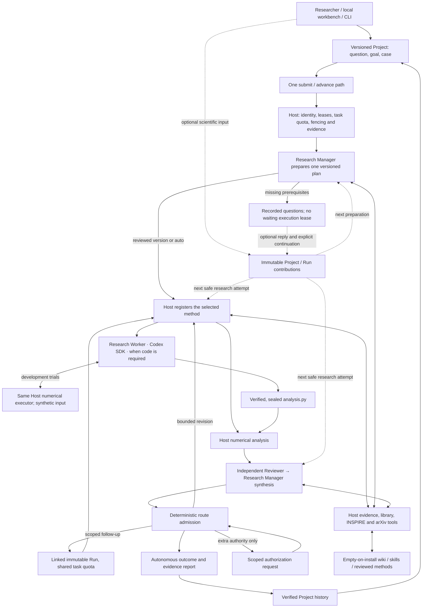

# Architecture

Each Project has a Research Manager to plan the investigation, a Research Worker to implement the method, and an independent Reviewer to examine the evidence. The Host executes the numerical program and publishes the result. The Research Manager synthesizes the scientific conclusion. Research can conclude without human participation. Operator scientific input is optional; extra execution authorization remains explicit.

## One execution authority

`runtime.py` accepts `ApplicationRequest` from CLI, Python and the loopback workbench. `submit` commits the business action; `advance` drives eligible admitted work. LangGraph routes over committed transitions. The shared native Host driver owns one file lock and uses the existing durable records as its queue. The browser has no second execution cursor or task database. Live scientific CLI work launches this same driver when work remains; the standalone coding demonstration retains its explicit delivery interface.

The control plane owns Run identities, authorization, leases, idempotency, cancellation and publication. WAL/FULL storage, boot/PID checks, source fencing and immutable accepted results remain. Coordinator schema 3 includes the shared research-task quota and rejects old Hosts. There is no in-place migration or rewriting of old accepted results; an original Host needs its original supported runtime. Scientific artifact and execution schemas retain their separately declared versions.

With a CodeHost, the product controller reuses its configured worker lease window for verification and publication; other workflows keep the 30-second controller default. Consumer execution remains bounded by its original capability deadline and active-time/Run/Attempt budgets. For generated research code, the backend command limit is 400 seconds, the producer deadline is 900 seconds, and the research-task dispatch deadline is 3,600 seconds. These retain their separate scopes; the controller lease covers metadata ownership and publication and grants no model or command execution authority.

`InvocationLeases.get` always reads the current SQL revision and raw value and rechecks its authorization digest and state. A one-entry cache reuses only strict JSON decoding of identical complete raw values; first and repeated reads return independent deep copies. Live fence and clock checks remain uncached, and parse failure never falls back to an older value.

Canonical JSON preserves finite scientific floating-point values without a magnitude ceiling. Integers retain the exact safe range ±(2**53 − 1); duplicate keys and non-finite values, including exponent overflow, are rejected. Explicit control `number()` bounds remain unchanged: invocation/producer deadlines and windows, and operation/invocation timestamps, are validated on each read. Serialization does not establish scientific validity.

A Project is scientific context. Each Run binds its Project revision, goal, dataset identity, case configuration and exact selected method sources. Project edits affect later admissions. The Project store cannot resume execution or grant authority. Exact committed request-key replay returns the original business result; a conflicting intent is rejected.

Project submissions first admit an intake Run. The Research Manager combines research framing, a supported executable method and scientific decision criteria. The Host checks the proposal against frozen inputs and registers the plan. In review mode a ready preparation closes without dispatching the Research Worker; in auto mode readiness can admit its scientific child. The formal Run registers the selected method under its own identity. Explicit revisions and executions compete for a single successor. Expired authority requires explicit new admission and fresh validation.

Missing prerequisites close preparation with `needs_information`; there is no live lease waiting for a person. A reply or Project input update can be explicitly continued from that preparation through the original start path. Same-key replay returns the original child; another key cannot continue the same parent twice. Preparation, clarification and scientific Runs share the original task limits and deadline. Comments cannot grant permissions, launch a model or extend the task. A new explicitly started investigation is a new task. A fully configured `run --case-config` enters its scientific Run directly. It shares the Research Manager’s proposal, correction and scientific criteria checks. A Project intake additionally resolves incomplete inputs and presents a selectable version.

Read-only status can observe a running research attempt with exactly one unsettled ordinary model/tool resource and no unknown execution settlement. It verifies the committed producer, original checkpoint/source and exact published resource suffix. Bare started state and gaps without an active resource retain the strict refusal path. Observation grants no dispatch or lease renewal. Unknown token/cost usage remains conservative accounting, distinct from an unknown execution settlement.

## Research roles and SDK boundaries

`research/collaboration.py` reuses `ScientificAgent` and the strict proposal contracts. A planning attempt runs the Research Manager; a review attempt contains independent Reviewer → Research Manager synthesis. These are separate model contexts inside the canonical work kinds. They share the configured research model; context separation alone does not establish independent model-family agreement or physical correctness. The Research Worker uses the backend interface in `code_agent/backend.py`. The Host performs numerical execution. New exchanges identify the Research Manager as `research_manager`. The `code_agent` attempt and `code` evidence slot identify execution and artifacts across builds. Archived exchanges retain the role recorded at the time.

The Python OpenAI Agents SDK supplies bounded tools and structured output. Combined Research Manager/Reviewer schemas use the same SDK strict conversion for counting and generation; nullable fields are required and allow null, while Host domain validation remains separate. Research transport retries, SDK sessions, handoffs, nested agents and SDK-owned approvals are disabled. The balanced policy permits eight model calls per research attempt, including compaction; during review the Reviewer uses at most half the remaining turns, leaving a conclusion allowance for Research Manager synthesis. The final allowance uses `tool_choice=none`, and Host hooks refuse a contrary tool effect. Incomplete responses remain failures. Tools execute serially with separate admission and settlement.

The same Host meter shares the existing tool and time allowance between sequential roles and reserves actual input counting and final generation. Exploratory tool batches that would consume this closing allowance receive `not_executed`; their audit event is `tool_not_executed`, never an executed-tool event or scientific evidence. The next request uses a counted, tool-free structured conclusion. Real admission, fencing, cancellation and tool errors still fail normally. Unaffordable compaction preserves the complete history only while it fits the hard input limit; it does not truncate evidence or grant more calls. SDK tool-output callbacks and adapters are unsupported so they cannot run outside this effect path.

Unanswered scientific questions remain unresolved and become implementation checks for the next plan. They do not require an implementation's future results before that implementation can begin, even when a role repeats them with issue status `blocked`. A role's explicit `need_information` decision identifies actual planning prerequisites; those still prevent implementation until answered with verified evidence. Review still requires evidence for every retained blocked question; permission and input admission remain Host decisions.

`ResearchMeter` admits each model/tool effect through its original scope. Ordinary resource journals verify each intent's publication state, digest, ownership and exact canonical prefix/index chain, then replay the complete ledger once; replay still validates every intermediate lifecycle and budget state. The original invocation lease, policy and per-request deadlines still apply. Cancellation drains owned effects; uncertain settlement cannot authorize redispatch. The request timeout is distinct from the original attempt window and the shared task dispatch deadline.

All deployment token limits are defined in [`settings.py`](../src/lqcd_agent/settings.py). Complete explicit inputs are counted before dispatch, including instructions, messages, tools and output schema. The hard input ceiling is 256,000; both research and Codex use the same 194,560-token compaction setting. Research generation permits 32,768 output tokens including reasoning. Native Codex has an explicit 128,000-token output cap, a 243,200-token effective window and native compaction. The Codex loopback gateway independently recounts every actual request after tool output, retry or compaction.

Research compaction retains initial scientific state verbatim, including the task, supplied constraints, diagnostics, unresolved issues and source identities. Full original evidence remains available. Protected state alone can exceed the soft threshold up to the hard ceiling. Counting failure, an oversized input or insufficient post-compaction headroom stops dispatch; no silent truncation occurs. Native compaction is observed from SDK events and provides working context, not new scientific evidence.

Command tools use the pinned native managed proxy with public-domain access, the default local/private-target guard, no Unix-socket allowlist, an ephemeral HTTP listener and SOCKS disabled. The SDK uses `ApprovalMode.deny_all` (native `never`), so a model cannot approve an escalation to reopen those boundaries. Model transport to the private loopback gateway remains outside the command sandbox. Numeric analysis and method/case calibration have network disabled, with that policy bound in their execution preparation.

The gateway uses one HTTPX pool per worker, rejects implicit remote history, alternate models/routes, WebSockets and automatic truncation, and owns connections through shutdown. Only read-only counting retries broken connections, at most three times inside its original deadline. The gateway never redispatches generation itself; native Codex owns transient generation recovery, and each repeated request is freshly counted and admitted. Unknown usage retains conservative reservations. Private traces contain digests/counts and bounded diagnostics, not credentials or request/error bodies. The native SDK writes files and returns paths; the Host independently verifies and seals their actual bytes.

## Autonomous conclusions and scoped experiments

The Research Worker exposes one `run_numerical_trial` tool over its existing private authenticated gateway. It reads only the bound workspace's current `analysis.py`, takes bounded model-supplied synthetic JSON and uses the original Run's scientific interpreter. The existing numerical executor performs the trial under the original coding tool/time allowance. A fenced intent precedes execution; exact source, input, output and known failure receipts become `numerical_trials.json` in the verified code bundle. Unknown execution is never silently replayed. Development feedback grants neither physics acceptance nor access to the private production dataset or withheld calibration results. Final Analysis continues to execute the independently sealed delivery.

The gateway holds each bounded native model response until its tool intents fit the original producer allowance and are durably registered. Native receives the unchanged response only after that admission, so a mixed command/trial batch cannot spend the remaining tool allowance twice through delayed notifications. This controls local native command/MCP dispatch; provider-hosted web search has already executed when the response arrives. The final native tool audit still checks actual execution. The numerical executor drains its process group before freezing output, including when the leading process exits successfully.

Normal scientific review no longer requires human approval. A terminal report records `scientific_outcome` (`supported`, `qualified`, `inconclusive`) and `decision_origin=system`, along with evidence and classification reasons. Ordinary caveats can yield a qualified system conclusion. Failed numerical contracts, blocked claims, incomplete evidence and exhausted budgets produce an inconclusive result. An accepted terminal classification is a scoped recorded conclusion, not proof that every physical assumption is correct.

Research Manager/Reviewer questions and answers retain attributable evidence. Disagreement or warnings cannot be erased to permit closure. Concrete executable revisions use the original bounded routes. Missing information can end the investigation inconclusively without waiting for an operator. A target exception is still propagated after a verified finished/failed Attempt without a registered result completes the original control closure; the same Project capture path saves the actual failure. Started or uncertain effects are not redispatched or automatically declared closed. Actual permission responses are recorded as `authorization_decision`, separately from scientific adjudication and operator contributions. A permissions/budget authorization or refusal cannot be relabeled as scientific endorsement or rejection. The human gate remains for explicit additional authority; it does not grant permission to bypass data-integrity, security or policy failures.

Research Manager can return a typed `next_experiment` in the sealed review collaboration. `research/experiments.py` admits supported parameter changes and reviewed local method selections through the original Host start path. New Runs retain the same dataset identity, interpreter, execution permissions and research-task account, and link back to the exact parent proposal/evidence. Source data cannot be replaced. Child slots are reserved before start for exact crash/idempotency reconciliation. Unsupported, repeated/no-progress or quota-exhausted proposals are recorded as unexecuted with a reason, rather than creating an endless driver loop.

The default shared task quota in `settings.py` permits four Runs, 128 actual model requests, 8,000,000 explicit input-plus-output reservation units and a 3,600-second dispatch deadline. Research and native Codex generation/compact requests, including SDK repeats, consume the same coordinator account. Starting another Run or reconnecting cannot replenish it. Missing usage keeps the maximum reservation. These units do not include every provider-internal context or hosted-tool fee and are not a USD billing ceiling. Already admitted work and cleanup remain constrained by their original fences and deadlines.

## Empty local assets and reuse

Each installation initializes empty `library/wiki`, `library/skills` and `library/methods`; no personal wiki is imported. Assets have immutable versions, applicability, source references, dependencies and candidate/reviewed/contested/superseded states. Review records attribute the actual operator or agent rather than inventing human approval.

Research tools can save candidates and independently review prior-attempt candidates using supporting evidence actually read in that attempt. Wiki/skill review remains an attributable scoped judgment. Method promotion additionally requires Host-executed finite independent calibration for the current C2 or Normalization family and exact source binding. An uploaded `passed: true` receipt cannot register a method. Unsupported generic contracts remain candidates. Finite calibration does not establish universal physics validity.

Candidate `source_urls` accept actual HTTP/HTTPS literature URLs. A Host context digest is not a literature URL; when no external citation applies, callers use an empty list. Malformed URL arguments return a specific correction before asset writes. Missing Host write authority, expired fencing, stale asset revisions and evidence failures still propagate rather than becoming successful candidate writes.

Current Run section IDs belong to `read_context`; Project member hashes belong to `read_project_evidence`. An unknown section returns `not_registered` with exact catalog lookup guidance, without file access, evidence or fuzzy matching. An unregistered Project lookup that matches a known current Run section returns the exact corrective call without reading it or broadening access. Actual reads retain the original registration, hash and path checks; changed or missing registered files and invalid page offsets still fail.

Generated Analysis publishes its complete `analysis_outputs/generated_result.json` as an immutable member alongside `run_result.json` metadata. The Host freezes the executed JSON bytes and the prepared output path before invoking the Agent. This replaces the duplicate metadata output wrapper and makes numerical comparisons, covariance diagnostics and replicas available through the existing evidence catalog and reader.

For C2 review, the Host gives both Reviewer and Research Manager the exact read identifier and SHA-256 of the current Analysis result when its registered producer and the diagnostic witness agree. Reading that member checks the path and digest and returns up to 48,000 characters with an explicit continuation offset. The role trace records the pages actually returned.

A selected reviewed method version is atomically snapshotted with source, applicability and validation identity. Admission freezes it into read-only `reused/` inputs for the sole coding backend. Final generated analysis remains self-contained. Stale, contested or changed dependencies cannot enter under an old review. The operator CLI uses the same lifecycle; method registration takes `--family` and `--python`, and executes Host calibration.

## Evidence and numerical contracts

Run input bytes, code, interpreter/library identity, parameters and outputs are bound by the existing evidence path. Model proposals select domain choices; Host code constructs executable paths. C2, Normalization and `replica_observables` retain deterministic Host checks. Successful fixed-energy C2 fits report finite `E0_error=0.0`, conditional on the imposed exact energy; this does not propagate external rest-energy uncertainty or replace a failed fit or replica. The general replica interface checks explicit sample identities and declared estimators without inferring physical configuration independence, units or resampling provenance.

Reviewer initial views retain Host findings and reference the full method through a digest-bound named read. Complete context, registered artifacts and Project/library evidence remain available through paginated tools. INSPIRE metadata and arXiv HTML use fixed public hosts, retained source hashes and bounded text reads; unavailable papers and uninspected figures remain explicit.

Optional operator contributions have immutable versioned records, exact Project identity, optional Run/head scope and registered evidence references. They enter Research Manager/Reviewer context at a later safe attempt, with full records available through named reads. Free text grants no authority and does not mutate sealed results or restart a closed Run.

`ProjectStore.capture_run` verifies registered producer scopes and copies bound evidence. Outcomes and actual decision provenance come from the terminal artifact and committed closure, rather than a required human approval. Project copies remain read-only history after Host loss, with no raw-data backup or recovery authority. Portable terminal archives retain their separate existing contract.

## Local deployment

The workbench uses loopback, exact origin, a session token, bounded JSON and registered evidence reads. Its navigation pointer contains only the managed Host locator. The shared CLI/workbench driver preserves the original workspace and private `.env`; keys are never sent to the browser or exported into child environments. Status does not launch a driver, renew authority or run a model. An actually absent old Host permits new work in a new Host; unsafe existing authority is not replaced.

Qualified execution remains native macOS with the canonical `/private/tmp` parent and owned local storage. Linux source/build checks do not qualify runtime execution. HPC, distributed workers, generic Research Manager/Reviewer shell access and arbitrary-QCD physics certification remain outside the implementation.
