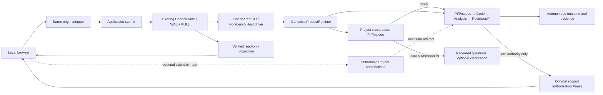

# Local research workbench

Start `lqcd-agent-workbench --port 8000` from the operator workspace, then open `http://127.0.0.1:8000`. Use `LQCD_AGENT_WORKSPACE` to select another owned workspace. The original private `.env` supplies live credentials; the browser never receives a key. No Node build, remote UI service or additional task database is needed. Restart after backend changes; active scientific builds are not hot-reloaded.

## One control path

The workbench supports versioned Projects, linked investigations, optional operator questions/comments/evidence, independent review exchanges and local assets. C2 window/energy plots and Normalization plots display committed aggregates; JavaScript performs no fitting or scientific adjudication. Execution state, scientific outcome and decision origin are separate. `supported`, `qualified` and `inconclusive` conclusions can be recorded without human participation. Synthetic fixtures remain explicitly labeled.

`runtime.submit` commits the original business action and returns `Submission(status, advance)`. `advance` drives eligible work through the existing fenced engine. HTTP returns after admission; the shared native driver continues independently of the browser/server. Live scientific CLI tasks use the same launcher and Host lock. It reconciles completed Code deliveries and scoped PI follow-up Runs using the existing control paths, without generating Human Responses or restarting uncertain work.

The private `.runtime/workbench-host.json` stores only a Host locator. Run history and authority come from coordinator tables and immutable ledgers. The shared task quota is visible separately from per-Run counters, including remaining model requests, token reservation units and Run slots. Unexecuted experiment reasons remain visible. A new Run, reconnect or worker restart cannot replenish that quota.

## Prepare a research project

Create a Project with its question and constraints. Starting configuration is optional; the **Data file**, **Data provenance** and **Scientific Python** fields populate a partial configuration. Declare whether the input is measured, resampled or synthetic; provenance has no default. Enable live research and start an investigation. PI/Postdoc first receive a Host-generated profile of the declared data and can consult the local library or literature. A supported prepared contract automatically starts the formal analysis. The prepared configuration is retained as evidence, leaving the user's Project inputs unchanged.

The preparation panel distinguishes `ready` and `needs_information` from a scientific conclusion. Missing prerequisites appear as concrete questions. Supply a scientific reply through **Join the research**. For missing data paths, provenance, interpreter or other structured metadata, use **Edit research inputs**; free text does not silently fill those fields. Then use **Continue research**. That explicit action inherits the preparation's original task budget and deadline. It cannot replenish resources, change model authorization or restart the old Run. Once the original task expires or is exhausted, **Start a new investigation** explicitly starts a separate task. Preparation and clarification each consume one of the existing four Run slots; no lease is kept alive while waiting for a person.

Ordinary comments never dispatch a model. If the needed facts are unavailable, the preparation remains inspectable without requiring human approval. Unsupported input formats require an explicit supported data contract; the interface does not upload or reinterpret arbitrary files automatically.

## Optional scientific participation

Select a Project and record a scientific comment, question or evidence reference. Input is Project-wide by default, or can be bound to the selected Run and observed execution head. Evidence entries use registered Project SHA-256 references; arbitrary paths and fabricated member IDs are rejected. The server stamps operator attribution and binds the current Project version. Inputs have immutable content-addressed records, a verified chain and original-key replay; they never mutate control logs or grant authority.

PI/Reviewer receive applicable contributions at the next safe research attempt, with full source records available through named reads. A new comment cannot change an already-started request or sealed result. Comments on closed investigations retain their original scope and do not restart them; Project-wide input can inform later investigations. The browser retains an unconfirmed form for exact retry. Forgetting that browser form does not remove any server record.

## Reconnection and authorization

Refreshing restores navigation; restarting HTTP reuses the private Host pointer and operation history. The driver survives HTTP shutdown. A fully admitted, unstarted invocation can continue. Started or partially published work without a verified checkpoint needs its original control recovery and is not blindly invoked again. Coordinator schema 3 rejects old Hosts; use original supported runtimes for their original authority, with no in-place migration.

During publication, inspection can be unavailable rather than asserting a stale Run status. Actions stay disabled until a complete checkpoint verifies. Unsafe/unverifiable Hosts are not replaced. An actually missing Host permits a new managed Host for new work, while saved Project evidence remains readable without execution authority.

Control submissions retain exact business payloads and operation keys. Reconnection reconciles the original operation before repeating that same intent/key. A replacement Host cannot consume an old pending control request. A new stale action or different content under an existing key is rejected. Scientific contributions use their own original-key record, without masquerading as control operations.

The authorization panel appears only for a scoped extra-authority request. Responses bind the original Pause, expected head, key, allowed decision, conditions and rationale. The server derives identities and allowed scope from committed records; comments or free-text rationale cannot enlarge it. Authorization does not imply human scientific endorsement or bypass an integrity/security failure. Cancellation uses the original Pause/stop owner and remains available without credentials or the data workspace; active ordinary invocations do not gain an unrestricted interrupt endpoint.

## Local API and evidence boundary

All endpoints bind to loopback and validate exact Host/Origin plus a per-server session token. Mutations require same-origin strict JSON, with duplicate-key/finite-value checks and a 64 KiB request limit. There is no CORS grant, caller actor, filesystem-root or shell-command endpoint. This is a single-operator application.

| Endpoint | Purpose |
| --- | --- |
| `GET /api/session` | Local session token and managed Host |
| `GET /api/cases` | Installed owned case configurations |
| `GET/POST /api/projects` | List/create Projects |
| `GET/POST /api/projects/{id}` | Inspect/version-check Project edits |
| `GET/POST /api/projects/{id}/contributions` | Attributed optional scientific input |
| `POST /api/projects/{id}/runs` | Start Project preparation, or explicitly continue its original intake parent |
| `GET /api/library` | Candidate/reviewed asset search |
| `GET /api/runs` | Verified Run navigation |
| `POST /api/runs` | Admit a configured case |
| `GET /api/operations/{key}` | Reconcile an original control action |
| `GET /api/runs/{host}/{case}/{run}` | Read-only control/scientific view |
| `GET …/evidence/{id}` | Verified registered text member, at most 4 MiB |
| `POST …/respond` | Original scoped authorization response |
| `POST …/cancel` | Original Pause cancellation |

Evidence resolves through a verified registry and exact producer scope. Changed bytes, traversal, foreign workspaces and redirected paths are rejected. Raw-data paths, `.env`, backend homes/worktrees and arbitrary workspace files are not evidence endpoints. Text/JSON/patch/SVG previews are plain text; stored HTML/SVG cannot execute. Binary previews are not supported.

Private temporary Hosts retain execution authority. Projects capture registered artifacts and bound sidecars at committed checkpoints; they are not raw-data backups or executable recovery databases. Imported CLI Runs remain inspectable in their original workspace; their control actions use the original CLI. See [Architecture](ARCHITECTURE.md), [Data/security](SECURITY_AND_DATA_POLICY.md) and [Verification](VERIFICATION_GUIDE.md).
