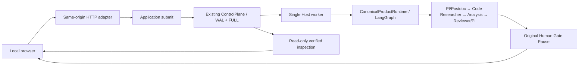

# Local research workbench

Start `lqcd-agent-workbench --port 8000` from the operator workspace, then open `http://127.0.0.1:8000`. Use the existing `LQCD_AGENT_WORKSPACE` to select another owned workspace. Install the updated package with the normal editable-install command after changing its entry points. No Node build, external assets, cloud UI service or additional task database is needed. Restart the service after backend/package changes; it does not hot-reload active research builds.

## One control path

The browser starts with Projects and the empty local library. It supports creating and version-checking Project edits, starting linked investigations, viewing independent review/PI exchanges and open issues, and searching candidate/reviewed assets. Recorded attempts, actual resource consumption, registered evidence and numerical plots remain visible. C2 energy/window plots and real/imaginary Normalization plots display already committed aggregates; JavaScript performs no fitting, normalization or scientific acceptance. Execution success, synthetic fixtures and scientific acceptance are displayed separately. A case requiring generated code requires explicit live activation; no key is accepted by or delivered to the browser.

`runtime.submit(ApplicationRequest(...))` returns `Submission(status, advance)` after the original control action commits. `runtime.advance(host, locator)` drives eligible admitted work through the same fenced engine. Synchronous `execute` uses those same functions. HTTP returns 202 after admission; the local worker continues independently of the HTTP request and browser. Resume validation remains in `CanonicalProductRuntime.resume_control`, and subsequent work uses the original Agent and Code ports. No Human Response is generated by the worker. All Python backend, HTTP and worker files participate in the application build fingerprint; static HTML/CSS/JavaScript changes do not change the scientific runtime identity.

The ignored, private `.runtime/workbench-host.json` contains only a Host locator. Run history, operation keys and outcomes come from existing coordinator tables and immutable ledgers. The worker's native file lock prevents duplicate workbench drivers; original CAS, leases, capabilities and stop ownership still decide authority. Completed Codex delivery and deadline enforcement use the existing resume and `CodeWatchdog` paths. Imported CLI Runs are inspectable within their original workspace; use their CLI for control actions.

## Reconnection and actions

Refreshing the browser restores the selected Run from its URL or local navigation state. Restarting the HTTP server reuses the Host pointer and original operation history. The worker survives HTTP shutdown; its single-Host lock prevents a replacement server from starting a second driver. A fresh worker can continue a fully admitted, unstarted invocation. Started or partially published work without a fully verified checkpoint requires original control recovery; it is never automatically invoked again.

Read inspection preserves the original full checkpoint and cross-head validation. During an in-progress publication, a Run can be listed as `inspection: unavailable` with no asserted Run status. The detailed view rejects inspection. The page labels its retained snapshot as historical, disables actions and polls for a verified checkpoint. This state may also indicate corruption or required recovery; it is not treated as proof that work is healthy or safe to retry.

Before a POST, the browser retains its exact business payload and operation key. On reconnection it first queries the original operation and otherwise repeats that same retained intent/key. It cannot create a fresh request while a retained submission is unresolved. Retained intent is bound to its original Host; a replacement Host cannot automatically consume or repeat it. The server's original control operation checks semantic identity and prevents duplicate effects. The HTTP head is a first-admission optimistic precondition; a committed exact control-operation replay can be reconciled after its original Pause has been consumed.

Human responses accept only an original Pause, expected head, key, allowed decision, conditions and rationale. The server binds Run, Cycle, Human Request and operator identity from original records. A new stale operation is rejected without mutation. Different content under the same key is rejected. Cancellation accepts only the original Pause/head/key and uses its existing resolution/stop owner. It does not require API credentials or the original data workspace. Cancellation is exposed when a cancelable Pause exists; it is not a general interrupt button for an active ordinary invocation.

## Local API and evidence boundary

All endpoints bind to loopback, validate exact Host/Origin, and use a per-server session token for API access. Mutations also require same-origin JSON. JSON is strict and duplicate-key/finite-value checked, with a 64 KiB request limit. Browser reconnection obtains a fresh session token after an HTTP restart. There is no CORS grant, caller-supplied actor, filesystem-root argument or shell-command endpoint. This is a single-operator local application, not remote or multiuser authentication.

| Endpoint | Purpose |
| --- | --- |
| `GET /api/session` | Same-origin session token and managed Host |
| `GET /api/cases` | Owned installed case configurations |
| `GET/POST /api/projects` | List or create local Projects |
| `GET/POST /api/projects/{id}` | Inspect or version-check a Project edit |
| `POST /api/projects/{id}/runs` | Start with a frozen Project version and original operation key |
| `GET /api/library` | Search local candidate/reviewed assets |
| `GET /api/runs` | Durable Run navigation, with explicit unavailable inspections |
| `POST /api/runs` | Admit one case with its operation key |
| `GET /api/operations/{key}` | Reconcile original admission or business action |
| `GET /api/runs/{host}/{case}/{run}` | Verified read-only scientific/control view |
| `GET …/evidence/{id}` | Verified registered text member, at most 4 MiB |
| `POST …/respond` | Original scoped Human Response |
| `POST …/cancel` | Original Pause cancellation |

Evidence IDs resolve through a verified artifact registry. Scientific sidecars additionally require their owning Attempt/Case/Run domain prefix and frozen digest. Unknown IDs, traversal, redirected paths, cross-producer members, changed bytes and foreign workspaces are rejected. Arbitrary raw-data paths, `.env`, backend homes and worktrees are not evidence endpoints. Text/JSON/patch/SVG previews render as plain text; stored HTML and SVG cannot execute. Summaries consume only their exact canonical scientific paths, not any file sharing a basename. Binary previews are not part of this version.

The Host remains in private temporary storage. Each Project Run copies verified registered evidence into its project at committed checkpoints. When a Host directory is actually absent, the workbench creates a new managed Host for new work and reads old Project evidence without enabling control actions. Permission errors or unverifiable existing Hosts never trigger replacement. Project evidence is not a raw-data backup or an executable recovery database. Unlinked legacy Runs still require explicit archival before temporary storage cleanup. A browser may explicitly forget a locally pending request; this neither retries nor cancels the original action.

## Verification

`python scripts/check.py tests/test_workbench.py tests/test_workbench_projects.py tests/test_delivery.py` exercises durable admission, refresh/server recreation, original-key replay, stale/scope/authority rejection, cancellation without workspace/credentials, evidence digest/traversal/producer/workspace checks, native worker continuation and refusal to repeat uncertain started work. HTTP checks cover Project version conflicts, original-key reconciliation after edits, retained history after Host loss, cross-project evidence refusal and permission errors. Browser inspection uses an isolated synthetic workspace; it does not create user library assets or invoke live models. All default checks use offline synthetic inputs and make no paid API calls. Real scientific decisions remain manual.
