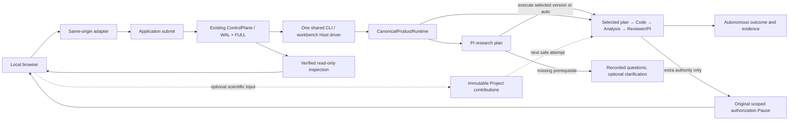

# Local research workbench

Start `lqcd-agent-workbench --port 8000` from the operator workspace, then open `http://127.0.0.1:8000`. Use `LQCD_AGENT_WORKSPACE` to select another owned workspace. The original private `.env` supplies live credentials; the browser never receives a key. No Node build, remote UI service or additional task database is needed. Restart after backend changes; active scientific builds are not hot-reloaded.

## One control path

The workbench supports versioned Projects, linked investigations, optional operator questions/comments/evidence, independent review exchanges and local assets. C2 window/energy plots and Normalization plots display committed aggregates; JavaScript performs no fitting or scientific adjudication. Execution state, scientific outcome and decision origin are separate. `supported`, `qualified` and `inconclusive` conclusions can be recorded without human participation. Synthetic fixtures remain explicitly labeled.

`runtime.submit` commits the original business action and returns `Submission(status, advance)`. `advance` drives eligible work through the existing fenced engine. HTTP returns after admission; the shared native driver continues independently of the browser/server. Live scientific CLI tasks use the same launcher and Host lock. It reconciles completed Code deliveries and scoped PI follow-up Runs using the existing control paths, without generating Human Responses or restarting uncertain work.

The private `.runtime/workbench-host.json` stores only a Host locator. Run history and authority come from coordinator tables and immutable ledgers. The shared task quota is visible separately from per-Run counters, including remaining model requests, token reservation units and Run slots. Unexecuted experiment reasons remain visible. A new Run, reconnect or worker restart cannot replenish that quota.

## Prepare a research project

Create a Project with its research question, constraints and available data. Declare the input provenance. The scientific interpreter and data file may be set in the Project editor. Planning can use the configured paid research model and named literature tools.

1. Leave **Review the PI plan before execution** selected and click **Plan with PI**. For unattended work, select **Execute automatically when ready** at launch. The PI investigates the declared inputs, local evidence and relevant methods and produces a plan. The preparation page shows the question, evidence, method, assumptions, decision criteria and expected outputs.
2. Review open questions together. Choose an option, enter a reply, or delegate a scientific preference. Missing measurements and provenance require attributable facts. Use the Project editor for structured input changes. Open **Request a revision**, submit the answers and any other changes once, then inspect the revised sections alongside the previous version.
3. **Save for later** returns to the Project. Open the saved preparation to resume. **Execute this plan** selects the displayed version for scientific execution. The initial formal Run registers that plan and passes its requirements to Code. Selecting a stale version cannot launch a second Run.
4. Read **Results**, **Code & trials**, **Review** and **All evidence** on the formal Run. The task timeline connects the preparation, its revision and the selected analysis.

Within the current task, planning and execution share the displayed Run, request and token allowances and deadline. Reading a plan and ordinary comments use no Run; each submitted revision costs one. If the account expires, **Recheck plan and start with a new budget** opens a separate task and records its source. Changed inputs require a new plan; previous evidence remains available. Archived captures have no execution authority.

## Optional scientific participation

In a formal analysis, open **Results**. C2 shows the actual fit windows, ground-state energies, uncertainties, χ²/dof and replica counts. Select a plotted point or table row to inspect its failed sample IDs. Normalization shows the real and imaginary components and the stored percentile summaries. Replica observables use their declared quantities, units and sampling groups where captured.

**View source record** opens the registered numerical output. **Discuss this record** attaches its digest and identifies the selected row in your scientific input. Use **Review** to follow recorded questions and responses. A source that resolves uniquely in this Run opens directly. The input history also opens evidence by the digest originally cited, including from the Project overview.

When a Project has a second completed formal analysis, open **Compare analyses** and choose it. The identity table shows the captured inputs, contract and output identities. Numerical rows appear together only when the required comparison identities match. Missing identities, different definitions and unmatched rows stay visible. A side-by-side comparison makes no statistical or physics judgment.

Select a Project and record a scientific comment, question or evidence reference. Input is Project-wide by default, or can be bound to the selected Run and observed execution head. Evidence entries use registered Project SHA-256 references; arbitrary paths and fabricated member IDs are rejected. The server stamps operator attribution and binds the current Project version. Inputs have immutable content-addressed records, a verified chain and original-key replay; they never mutate control logs or grant authority.

PI/Reviewer receive applicable contributions at the next safe research attempt, with full source records available through named reads. A new comment cannot change an already-started request or sealed result. Comments on closed investigations retain their original scope and do not restart them; Project-wide input can inform later investigations. The browser retains an unconfirmed form for exact retry. Forgetting that browser form does not remove any server record.

## Reconnection and authorization

Refreshing restores navigation; restarting HTTP reuses the private Host pointer and operation history. The driver survives HTTP shutdown. A fully admitted, unstarted invocation can continue. Started or partially published work without a verified checkpoint needs its original control recovery and is not blindly invoked again. Coordinator schema 3 rejects old Hosts; use original supported runtimes for their original authority, with no in-place migration.

During publication, inspection can be unavailable rather than asserting a stale Run status. Actions stay disabled until a complete checkpoint verifies. Unsafe/unverifiable Hosts are not replaced. An actually missing Host permits a new managed Host for new work, while saved Project evidence remains readable without execution authority.

An open browser polls verified activity and budgets. It reloads scientific detail when the artifact revision changes. Reading a preview verifies the requested bytes again. Unsent scientific drafts survive polling and switching between Runs within the tab. Archived records expose their captured Run budget and explicitly identify the unavailable live shared-task balance.

Control submissions retain exact business payloads and operation keys. Reconnection reconciles the original operation before repeating that same intent/key. A replacement Host cannot consume an old pending control request. A new stale action or different content under an existing key is rejected. Scientific contributions use their own original-key record, without masquerading as control operations.

The authorization panel appears only for a scoped extra-authority request. Responses bind the original Pause, expected head, key, allowed decision, conditions and rationale. The server derives identities and allowed scope from committed records; comments or free-text rationale cannot enlarge it. Authorization does not imply human scientific endorsement or bypass an integrity/security failure. Cancellation uses the original Pause/stop owner and remains available without credentials or the data workspace; active ordinary invocations do not gain an unrestricted interrupt endpoint.

## Local API and evidence boundary

All endpoints bind to loopback and validate exact Host/Origin plus a per-server session token. Mutations require same-origin strict JSON, with duplicate-key/finite-value checks and a 64 KiB request limit. There is no CORS grant, caller actor, filesystem-root or shell-command endpoint. This is a single-operator application.

| Endpoint | Purpose |
| --- | --- |
| `GET /api/session` | Local session token and managed Host |
| `GET /api/cases` | Installed owned case configurations |
| `GET/POST /api/projects` | List/create Projects |
| `GET/POST /api/projects/{id}` | Inspect/version-check Project edits |
| `GET/POST /api/projects/{id}/contributions` | Attributed optional scientific input |
| `POST /api/projects/{id}/runs` | Create a PI plan, or revise, execute or renew a digest-bound version |
| `GET /api/library` | Candidate/reviewed asset search |
| `GET /api/runs` | Verified Run navigation |
| `POST /api/runs` | Admit a configured case |
| `GET /api/operations/{key}` | Reconcile an original control action |
| `GET /api/runs/{host}/{case}/{run}` | Read-only control/scientific view |
| `GET /api/projects/{id}/runs/{key}` | Verified live or captured Project Run. Either Run view accepts `?details=false` for activity and its detail revision |
| `GET …/evidence/{id}` | Verified registered text member, at most 4 MiB |
| `POST …/respond` | Original scoped authorization response |
| `POST …/cancel` | Original Pause cancellation |

Evidence resolves through a verified registry and exact producer scope. Changed bytes, traversal, foreign workspaces and redirected paths are rejected. Raw-data paths, `.env`, backend homes/worktrees and arbitrary workspace files are not evidence endpoints. Text/JSON/patch/SVG previews are plain text; stored HTML/SVG cannot execute. Binary previews are not supported.

Private temporary Hosts retain execution authority. Projects capture registered artifacts and bound sidecars at committed checkpoints; they are not raw-data backups or executable recovery databases. Imported CLI Runs remain inspectable in their original workspace; their control actions use the original CLI. See [Architecture](ARCHITECTURE.md), [Data/security](SECURITY_AND_DATA_POLICY.md) and [Verification](VERIFICATION_GUIDE.md).
